# WEB5LAB
JAVASCRIPT
https://choilrul48-create.github.io/WEB5LAB/
1.	Menambahkan JavaScript

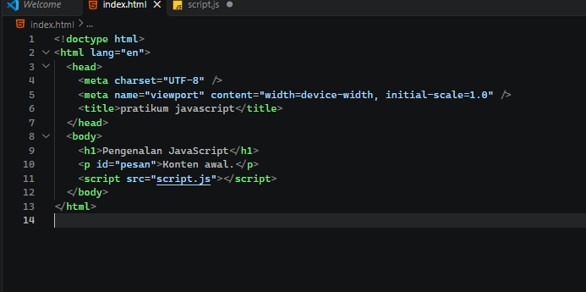

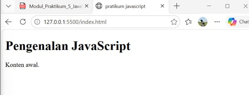

2.	Output dan dialog

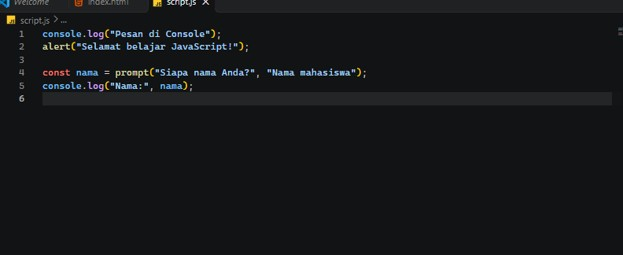

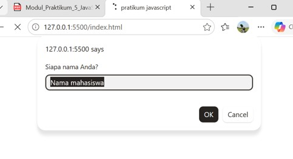

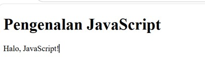

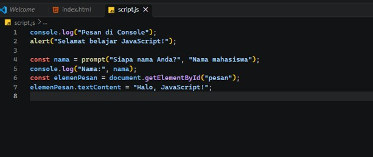

3.	Variabel, tipe data, dan operator

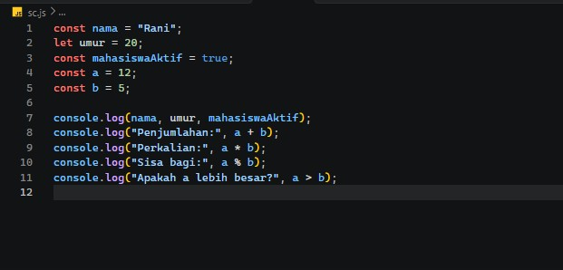
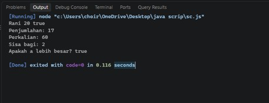

	

4.	Function

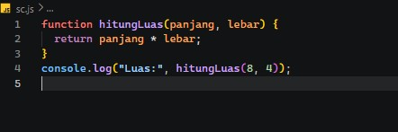

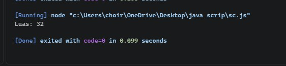

5.	Percabangan if–else dan switch

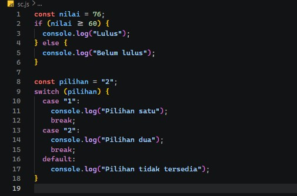
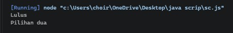

6.	Perulangan

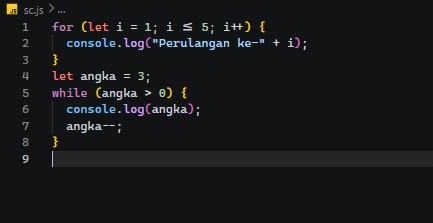

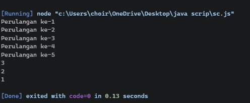

7.	DOM, form, dan gaya elemen

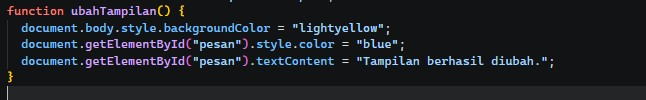

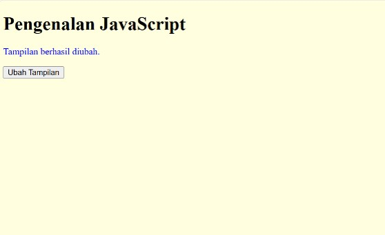

	

Pratikum 2
Latihan 1 — Menampilkan output

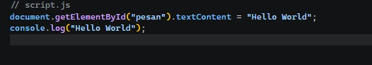

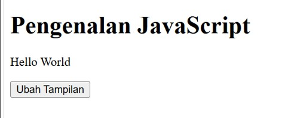

Latihan 2 — Alert dan prompt 

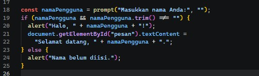

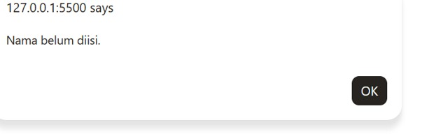

Latihan 3 — Function dan operasi aritmetika

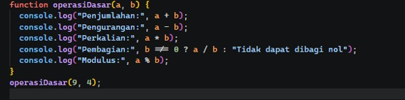
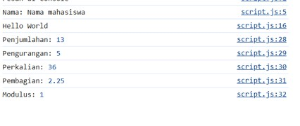

Latihan 4 — Seleksi kondisi if–else

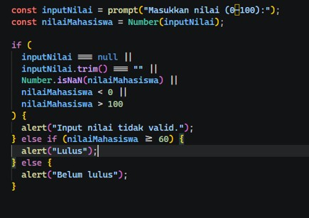
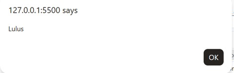

Latihan 5 — Seleksi kondisi switch

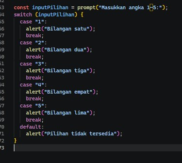

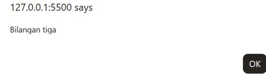

Latihan 6 — Form bilangan genap atau ganjil

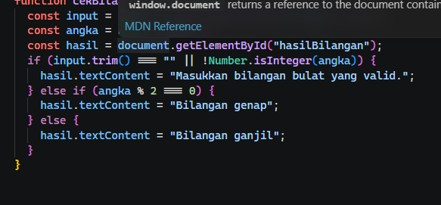
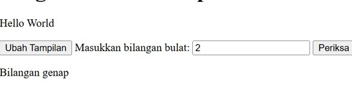

Latihan 7 — Mengubah warna halaman

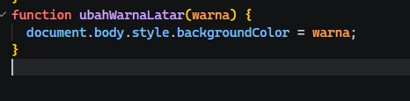
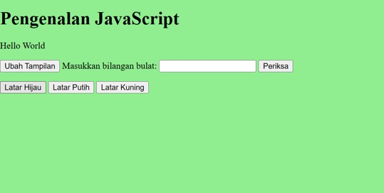

Latihan 8 — DOM dan checkbox menu makanan

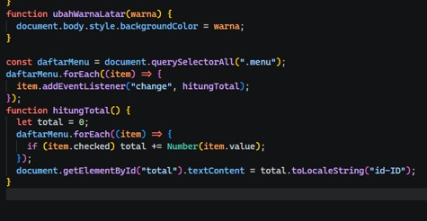

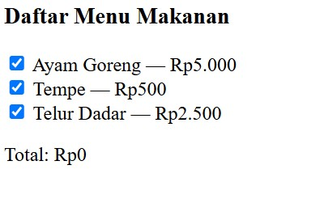

F. Mini Project — Kalkulator Nilai Mahasiswa
  
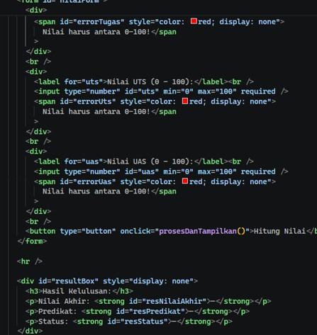

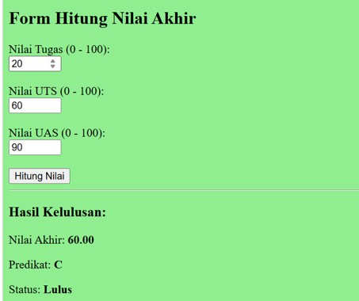

Eksperimen mandiri

1.	Ubah Latihan 3 agar menerima dua nilai dari prompt dan mengonversinya menjadi number.

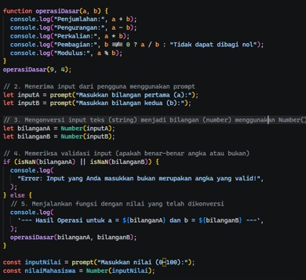
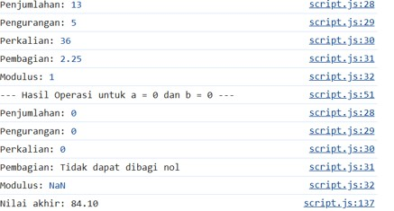

8.	Buat perulangan untuk menampilkan tabel perkalian angka 7 dari 1 sampai 10.
  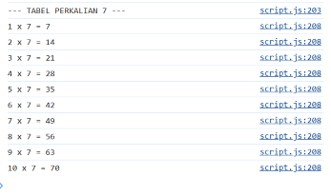

   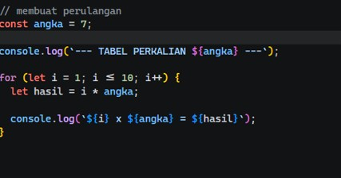

10.	Buat function cekGenap(angka) yang mengembalikan true jika angka genap.

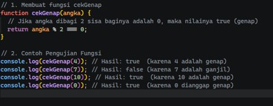

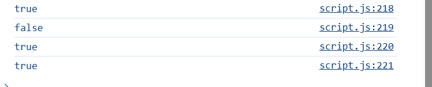

	

11.	Tambahkan validasi form agar kolom tidak boleh kosong.

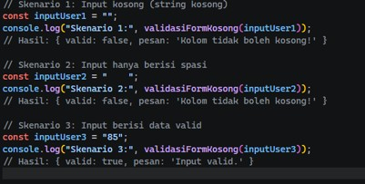

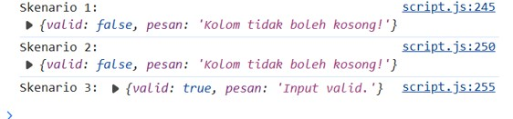

12.	Ubah Latihan 8 dengan menambah minimal dua pilihan menu dan harga.

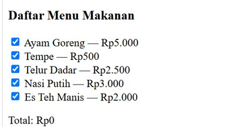

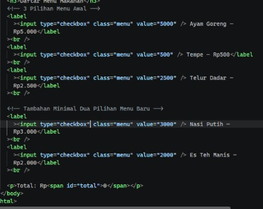

 
13.	Gunakan tombol untuk menyembunyikan atau menampilkan elemen HTML.

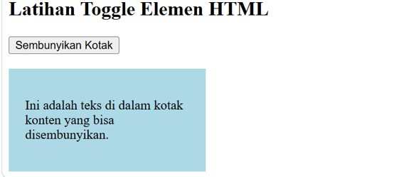
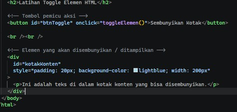

